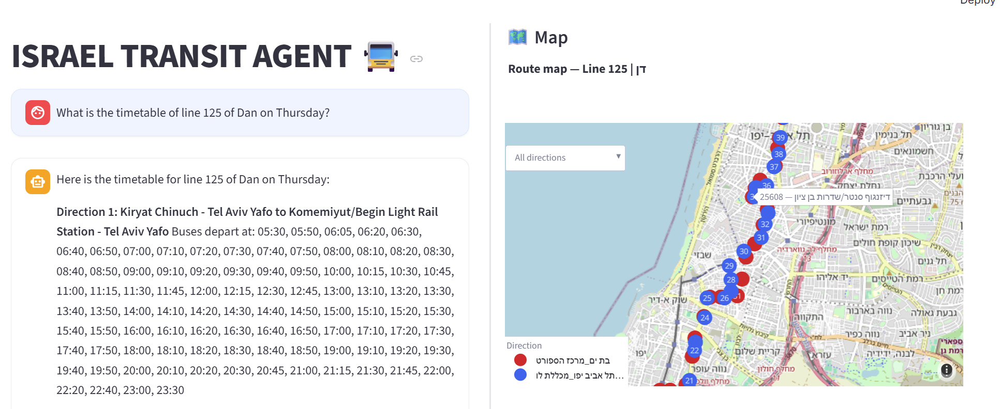
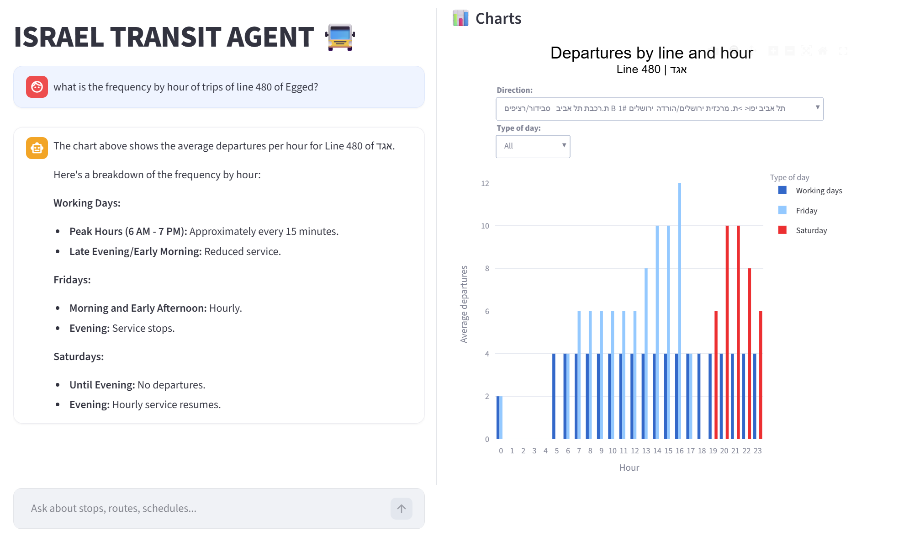

# 🚍 Israel Transit Agent

An AI agent that answers natural-language questions about Israeli public transport — bus lines, stops, routes, schedules, and operators — by querying the official GTFS schedule data through a conversational chat interface.

Ask in plain language ("What is the first stop of line 5?", "מה לוח הזמנים של קו 18 ביום חמישי?", "Which has more stops, line 5 or line 4?") and the agent figures out which database queries to run, handles ambiguity (a line number can belong to many operators), and answers in your language.

Built with **Tamir Edelstein** (Elia Transportation Engineering) for **Bar-Ilan University's Data
Science programme**. Work in progress.





*Above: a route map is drawn as soon as a line is identified. Below it: departure frequency by
hour and day type, generated on request.*

---

## What it does

- **Natural-language questions** about lines, stops, routes, schedules, and operators, in Hebrew or English — the agent replies in whichever language you asked in.
- **Smart disambiguation:** a line number like "5" is run by many operators in many cities. Instead of guessing, the agent presents a numbered list and lets you choose.
- **Stop lookups:** first stop, last stop, number of stops, and the full ordered list of stops per direction — rendered as a real table, never retyped as prose.
- **Departure timetables:** exact departure times for a specific day, per direction.
- **Frequency charts:** average departures per hour by day type (working days / Friday / Saturday), as an interactive chart.
- **Multi-line comparison:** questions naming two or more lines (e.g. "which has more stops, line 5 or line 4?") are broken into sub-questions and resolved automatically, with a comparison chart and combined map.
- **Map view:** plots stops on an interactive map of Israel, with the route drawn as a line and directions selectable from a dropdown — shown automatically the moment a line is identified.
- **Automatic model fallback:** tries a chain of free-tier LLMs (Gemini, then Groq models) and silently switches to the next one if a provider hits a rate limit, quota, or outage — no user action needed.

### Out of scope (by design)
These rely on data not part of the static GTFS schedule this app loads:
- Real-time vehicle locations or delays (would require a live SIRI feed)
- Fares / ticket prices (`fare_rules` isn't loaded)
- Route distance/geometry (`shapes` isn't loaded — the map plots stop points, not road geometry)

---

## How it works

The project is a classic **ReAct agent loop**: the LLM cannot fetch data itself, it can only request a tool. The code runs the tool, feeds the result back, and the model decides the next step — until it has enough to answer. It's hand-rolled (no LangChain or similar framework) so every retry, fallback, and safety check is explicit in `agent/core.py`.

```
User question
     │
     ▼
  app.py  ───────────────►  core.py  (the agent loop)
 (Streamlit UI)                │
                               │  sends question + system prompt + tool list
                               ▼
                     LLM (Gemini / Groq — auto fallback chain)
                               │  "call get_line_variants('5')"
                               ▼
                          tools.py  ──────►  gtfs_db.py
                       (tool functions)     (local DuckDB)
                               │
                               ▼
                     result fed back to the LLM → final answer
```

For questions that name two or more lines, `core.py`'s **scoped sequencer** takes over instead: it resolves each line and sub-goal (stop count, agency, first/last stop) one at a time using the same tools, with no extra LLM reasoning beyond deciding whether the sequencer is needed at all.

### File roles

| File | Role |
|------|------|
| `app.py` | Streamlit UI — chat, sidebar, live map/chart panel. The only file the user interacts with. |
| `agent/core.py` | The agent loop: talks to the LLM, runs tools, manages clarification flow and the multi-line sequencer, handles model fallback/retries, and runs deterministic anti-hallucination checks on the final answer. |
| `agent/tools.py` | The tool functions (see below) plus the cross-turn `selection_state` used for disambiguation. |
| `agent/prompts.py` | The system prompt that instructs the LLM how to behave and use the tools. |
| `agent/gtfs_db.py` | Downloads the national GTFS feed and loads it into an in-memory DuckDB database. |
| `agent/utils.py` | Builds and caches the correct LLM client for a given provider. |
| `config.py` | Reads `.env`, holds API keys, and defines `MODEL_PRIORITY` — the ordered fallback chain of (provider, model) pairs tried for every query. |

### Tools available to the LLM

| Tool | Purpose |
|------|---------|
| `get_line_variants` | Resolve a line number to its agency/route; asks for clarification if ambiguous. Always called first for a line question. |
| `select_option` | Maps a user's numbered reply back to the pending agency/route/direction choice. |
| `get_line_directions` | Lists a line's directions (headsigns) before fetching stops. |
| `get_line_stops` | Full ordered stop list per direction (name, code, coordinates, sequence). |
| `get_departure_timetable` | Exact departure times for a specific day, grouped by direction. |
| `get_departure_schedule` | Average departures/hour by day type — always followed by `plot_departure_schedule`. |
| `plot_departure_schedule` | Renders the frequency data as an interactive chart. |
| `get_schema` | Table/column reference, for meta/technical questions. |
| `run_sql` | Read-only `SELECT` against the DuckDB tables — last resort for anything the tools above can't answer. |

The route map isn't an LLM-callable tool — `plot_route_map`/`plot_multi_line_map` are triggered deterministically by the app itself whenever a line is identified, not decided by the model.

### The disambiguation flow (a key idea)

Because the LLM has no memory between turns, the project keeps a small `selection_state` dictionary in `tools.py`. When the agent shows a numbered list of operators/routes/directions and pauses, that state remembers what was asked. When the user replies with a number, `select_option()` uses the stored state to map the number back to the right value and continue.

### Guarding against hallucination

Stop lists and departure times are always rendered from real tool data in the UI (`render_stops_table`/`render_timetable`), and the model is instructed never to retype them as prose. `core.py` also runs deterministic checks before an answer is accepted — e.g. `_claims_facts_without_fetching` flags stop/time-shaped content the model wasn't supposed to write itself, and `_verify_stop_counts` cross-checks any stated stop count against the real tool results — rather than trusting an LLM to fact-check its own output.

---

## Data

Schedule data comes from the Israeli Ministry of Transport GTFS feed:
`https://gtfs.mot.gov.il/gtfsfiles/israel-public-transportation.zip`

It is downloaded once and loaded into a local in-memory **DuckDB** database, so queries are fast and require no live API calls. The following tables are loaded: `agency`, `stops`, `routes`, `trips`, `stop_times`, `calendar`. `calendar_dates`, `shapes`, `translations`, and `fare_rules` are excluded to fit cloud memory limits (~1GB RAM on Streamlit Community Cloud) — which is why the map plots stop points, not exact road geometry, and why fares/distance questions are out of scope.

---

## Setup

### 1. Clone and enter the project
```bash
git clone https://github.com/ofer-geo/GTFS-Data-Agent.git
cd GTFS-Data-Agent
```

### 2. Create a virtual environment and install dependencies
```bash
python -m venv .venv
# Windows
.venv\Scripts\activate
# macOS / Linux
source .venv/bin/activate

pip install -r requirements.txt
```

### 3. Configure API keys
Create a file named `.env` in the project root:
```
GROQ_API_KEY=your-groq-key
GOOGLE_API_KEY=your-google-key
OPENAI_API_KEY=your-openai-key
ANTHROPIC_API_KEY=your-anthropic-key
```
By default (`config.py`'s `MODEL_PRIORITY`), the agent only tries **Google Gemini** and **Groq** models, in this order — so at minimum `GOOGLE_API_KEY` and `GROQ_API_KEY` are required. `OPENAI_API_KEY`/`ANTHROPIC_API_KEY` are supported by the code (`agent/utils.py`) but not currently in the fallback chain; add an entry to `MODEL_PRIORITY` to bring OpenAI or Anthropic models into rotation.

> **Note:** `.env` is git-ignored and must never be committed.

### 4. Run
```bash
streamlit run app.py
```
The app opens at `http://localhost:8501`. The first run downloads and loads the GTFS data (may take a minute); later runs are fast.

### Deploying to Streamlit Community Cloud
`.env` isn't deployed with your repo. Instead, add the same key/value pairs under your app's **Settings → Secrets** on share.streamlit.io (flat `KEY = "value"` lines, no `[section]` header) — Streamlit exposes them as real environment variables automatically, so no code changes are needed.

---

## Example questions

- What is the first stop of line 5?
- How many stops does line 189 have?
- What is the timetable of line 125 on Thursday?
- How often does line 13 of Metropolin run?
- Which has more stops, line 5 or line 4?
- Show the stops of line 18 on a map

---

## Notes & limitations

- **LLM provider limits:** free tiers can still be exceeded by heavier, multi-step questions, especially once every model in `MODEL_PRIORITY` is exhausted for the day — the agent reports the switch as it happens rather than failing silently.
- **Tool-calling reliability** varies by model; the fallback chain favors this by trying the strongest available free-tier model first.
- Departure time at a *specific stop* (rather than at the line's origin) isn't supported yet.
- The agent answers only from the GTFS database — it does not answer transport questions from memory.

---

## Tech stack

Python · Streamlit · DuckDB · Plotly · multi-provider LLM tool-calling (Google Gemini / Groq, with OpenAI / Anthropic supported in code)

---

## Authors

**Ofer Shahal** and **Tamir Edelstein**, Bar-Ilan University Data Science programme.
Project page: [ofer-geo.github.io/personal_portfolio](https://ofer-geo.github.io/personal_portfolio/projects/gtfs-transit-agent/)
